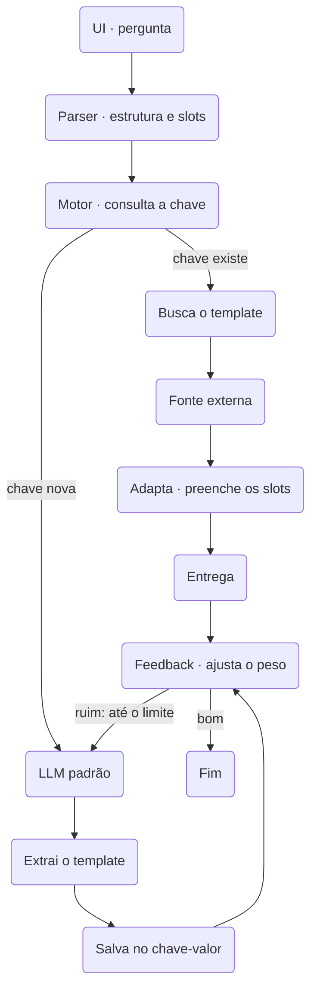

# Orquestração de respostas baseada em templates

Repositório do protótipo do TCC **"Orquestração de respostas baseada em templates: reaproveitamento de estruturas de resposta para reduzir a dependência de modelos de linguagem"** (Ciência da Computação, FAM, 2026).

A ideia: em vez de chamar o LLM a cada pergunta, o orquestrador guarda a **estrutura** (template) das respostas numa base chave-valor. Um parser extrai a estrutura e os slots da pergunta:
- **chave conhecida:** recupera o template, busca o dado numa fonte externa e preenche os slots, sem chamar o LLM de geração;
- **chave nova:** o LLM padrão responde, o template é extraído da resposta e salvo com peso inicial 0,5.

O feedback do usuário ajusta o peso de cada template (média móvel), respostas mal avaliadas voltam ao LLM até um limite de tentativas, e templates abaixo de um limiar são descartados.



O protótipo é construído sobre um editor de diagramas em que **cada retângulo é uma persona de IA** e **as setas dizem quem responde a quem** (vem do [mermaid-ai-draw](https://github.com/lucasisabelf/mermaid-ai-draw), licença MIT, migrado de TypeScript para C#). O orquestrador do TCC entra como mais um **motor** de persona, ao lado do Claude Code (MCP), do Ollama e da API da Anthropic.

## Como rodar

Precisa só do [.NET 10 SDK](https://dotnet.microsoft.com/download). Uma compilação só, sem Node:

```bash
dotnet run --project src/Orquestracao.Web     # abre em http://localhost:5190
dotnet test                                   # xUnit + Playwright
```

- **Front:** JavaScript puro (ES modules) em `src/Orquestracao.Web/wwwroot`, servido pelo próprio ASP.NET. Não há build de front.
- **Diagramas:** ficam em `src/Orquestracao.Web/diagrams/` (fora do git). Para usar outra pasta: `Diagramas__Pasta=/caminho dotnet run …` (ou `MERMAID_DRAW_DIR`).
- **Testes de navegador:** na primeira vez, o próprio teste baixa o Chromium do Playwright. Num Linux sem as bibliotecas do navegador, rode uma vez `pwsh tests/Orquestracao.E2E.Tests/bin/Debug/net10.0/playwright.ps1 install --with-deps chromium`.

## Os motores

Cada persona escolhe o **motor** que lhe dá voz, e personas de motores diferentes conversam entre si. O topo do chat mostra quais estão disponíveis.

| Motor | Quem fala | Precisa de | Custo |
|---|---|---|---|
| **MCP · Claude Code** | o Claude Code conectado ao servidor MCP do app (`/mcp`) | só o Claude Code aberto na pasta (o `.mcp.json` já aponta para cá) | o do seu plano |
| **Ollama · local** | um modelo local no [Ollama](https://ollama.com) (ex.: `qwen2.5:3b`) | o Ollama instalado (no WSL, o do Windows é achado pelo gateway) | grátis |
| **API · Claude** | a API da Anthropic, pelo SDK oficial em C# (streaming, prompt em cache) | `ANTHROPIC_API_KEY` (ou `ant auth login`) | por token: o chat soma o custo |
| **Template · orquestrador** | o orquestrador do TCC (veja abaixo) | o motor de fallback da persona | só o das chaves novas |

### MCP: o Claude Code dá voz às personas

Com o servidor rodando, abra o Claude Code na pasta do projeto e peça, por exemplo: *"Comece um debate no diagrama X sobre Y e dê voz às personas."* As ferramentas são `listar_diagramas`, `ver_personas`, `iniciar_conversa`, `proxima_vez` (os turnos pendentes), `responder` (a fala, ou `delegacoes` numa tarefa), `ver_conversa`, `sintetizar` e `parar`.

## As personas

Cada retângulo tem um `.md` em `diagrams/<diagrama>/personas/<id>.md`: o texto é o prompt (quem ela é) e o bloco yaml traz as opções. O nome é o texto do retângulo.

````md
# Cética

Você é a Cética do grupo. Questiona premissas, procura riscos…

```yaml
motor: api              # mcp · ollama · api · template
modelo: claude-opus-5-5 # no ollama, ex.: qwen2.5:3b
esforco: medium         # low · medium · high · xhigh · max (motor api)
papel: debatedora       # debatedora · moderadora (sintetiza) · orquestradora (delega) · executora
cor: "#e11d48"
```
````

- **Paleta:** os papéis ficam em [`templates/*.md`](templates), agrupados por motor na aba **Componentes**; o modelo padrão de cada motor está no yaml de cada papel.
- **Persona de saída** (`saida: true`, `arquivo: README.md`): não fala nas rodadas; no fim, preenche o template em `personas/<id>.saida.md` e o chat oferece o `.md` para baixar.
- **Persona humana** (`humana: true`): é você. Na vez dela, a conversa espera e o chat mostra **Aprovar**, **Pedir mudança** (quem falou antes refaz) ou **Encerrar**; `prazo` (minutos) e `aoVencer: seguir | encerrar` são opcionais.
- Os campos da persona de memória (`memoria`, `escuta`, `curadoria`…) e o pós-fluxo (`depois`) são lidos e validados, mas **não agem nesta versão** (fora do escopo do TCC).

## Os modos

| Modo | O que acontece |
|---|---|
| **Debater** | N rodadas pelas setas. Quem não tem seta chegando abre a rodada; cada persona fala uma vez por rodada e responde a quem aponta para ela |
| **Debater e responder** | o debate e, no fim, a **síntese** pela persona de papel *moderadora* (ou pela última que falou) |
| **Tarefa** | a *orquestradora* delega pelas setas (`DELEGAR <persona>: <tarefa>`, ou `delegacoes` no MCP); as delegadas trabalham **em paralelo** e ela consolida a entrega |

Durante a conversa: escreva no chat (com **@nome** a persona responde a seguir), **Sintetizar** pede a resposta polida, **Parar** cancela os turnos pendentes. No canvas, quem tem a vez brilha e a "mensagem" percorre a seta.

## API

Tudo o que o front faz passa pela API HTTP (JSON), e cada mudança chega às abas abertas por Server-Sent Events.

```bash
D=localhost:5190/api/d/meu-diagrama
curl localhost:5190/api/diagrams                              # lista; POST {name} cria
curl -X POST $D/nodes -d '{"text":"Parser","x":200,"y":100}'  # retângulo
curl -X POST $D/edges -d '{"from":"Parser","to":"Motor"}'     # seta (id ou texto)
curl -X POST $D/edges/e1/pulse -d '{"label":"chave nova"}'    # uma mensagem pela seta (efêmera)
curl $D/diagram                                               # código Mermaid; PUT substitui tudo
curl $D/events                                                # SSE do diagrama e do chat
curl -X POST $D/templates/cetica -d '{"motor":"api"}'         # retângulo + persona a partir do papel
curl -X POST $D/conversas -d '{"assunto":"…","modo":"resposta","rodadas":2}'
curl -X POST $D/conversas/<id>/humano -d '{"acao":"aprovar"}' # aprovar · mudar · encerrar
```

| Rotas | Para quê |
|---|---|
| `/api/diagrams`, `/api/diagrams/{slug}[/duplicate\|/export]`, `/api/diagrams/import`, `/api/events` | vários diagramas (uma pasta cada), exportar/importar `.zip` e `.mmd`, a lista ao vivo |
| `/api/d/{slug}/nodes`, `/edges`, `/diagram`, `/diagram.json`, `/events` | o diagrama, elemento a elemento (`X-Rev` em toda resposta); sem o prefixo, valem para o primeiro diagrama |
| `/api/mermaid/ler`, `/api/mermaid/gerar` | o código Mermaid, sem estado (o painel de código do front usa) |
| `/api/templates`, `/api/motores`, `/api/d/{slug}/templates/{papel}`, `/personas[/{id}[/saida]]` | papéis, motores e personas |
| `/api/d/{slug}/conversas[/{id}[/mensagens\|sintetizar\|parar\|humano\|saidas/{arquivo}]]` | as conversas |
| `/api/orquestrador`, `/api/orquestrador/perguntar\|feedback\|templates\|events` | o orquestrador por template: estatísticas, perguntar, feedback, templates e o SSE das etapas |
| `/mcp` | o servidor MCP (Streamable HTTP) |

## O orquestrador por template (o TCC)

O código fica em `src/Orquestracao.Templates`, e cada parte do fluxo está atrás de uma interface (o LLM, a base chave-valor e a fonte externa), para os testes trocarem por simulados e contarem as chamadas com exatidão.

| Requisito | Onde | O que faz |
|---|---|---|
| R01 | `Parser.cs` | `ParserHeuristico` acha a entidade na fonte e normaliza o resto: "Qual é a capital da França?" e "Me diga a capital do Japão" geram a chave `capital {pais}`. `ParserLlm` pede a estrutura ao Claude Haiku; `ParserHibrido` só chama o LLM quando a heurística não acha a entidade |
| R02 | `Orquestrador.cs` | consulta a chave: template existente (e peso acima do limiar) ou chave nova |
| R03 | `FonteDeFatos.cs`, `Extrator.cs` | a fonte externa é `dados/fatos.json` (33 países e 25 elementos); o template é preenchido com o dado atual e com a preposição certa ("da França", "do Japão", "dos Estados Unidos") |
| R04 | `Extrator.cs`, `TemplateStore.cs` | o template é extraído da resposta do LLM sem outra chamada (os valores da fonte viram slots: `A capital {de_entidade} é {capital}.`) e salvo em SQLite com peso 0,5; resposta sem dado da fonte não vira template |
| R05 | `Orquestrador.Feedback` | peso = α·nota + (1 − α)·peso (α = 0,3); abaixo de 0,2 o template é descartado; depois de um feedback ruim a resposta volta ao LLM, até 2 tentativas |
| R06 | `/mcp` | `perguntar_orquestrador`, `avaliar_resposta` e `ver_orquestrador`, além da persona com `motor: template` nas conversas |
| R07 | `Estatisticas`, `TemplateStoreSqlite` | perguntas, acertos de template, chamadas ao LLM de geração e ao parser, tokens, custo e latência (`GET /api/orquestrador`), gravados no SQLite a cada pergunta |

**Usar:** arraste o papel **Respondedor** do grupo **Template · orquestrador** na paleta (ou dê `motor: template` e `fallback: api | ollama | mcp` a qualquer persona) e ligue a ele uma persona humana (**Você**): **Aprovar** é feedback bom e **Pedir mudança** é ruim. O painel **Orquestrador** (`/orquestrador.html`) pergunta direto, mostra a chave, o template, o peso e as chamadas, recebe 👍/👎 e desenha a Figura 1 com o caminho destacado; o diagrama **Orquestrador por template** mostra cada etapa percorrendo a seta no canvas.

**A base fica no repositório:** `dados/orquestrador.db` (SQLite) guarda os templates com o peso e o histórico de cada pergunta respondida e de cada feedback. As estatísticas do painel são recompostas dela ao reiniciar. É a prova do uso do protótipo; os testes usam bases temporárias e não mexem nela. A base do experimento real está em `docs/experimento/experimento-mcp.db`.

**Configurar** (`appsettings.json` ou variáveis `Orquestrador__…`): `Parser` (`heuristico` · `llm` · `hibrido`), `ModeloParser` (padrão `claude-haiku-5-5`), `Banco` (o arquivo SQLite; padrão `dados/orquestrador.db`), `Fatos` (a base de fatos) e `Peso:PesoInicial`, `Peso:Alfa`, `Peso:Limiar`, `Peso:LimiteTentativas`.

## O experimento

```bash
dotnet run --project src/Orquestracao.Experimento                  # LLM simulado: reprodutível e sem custo
dotnet run --project src/Orquestracao.Experimento -- --llm api     # Claude Sonnet 5.5 na geração, Claude Opus 5.5 como juiz
```

O conjunto tem 150 perguntas sorteadas (semente 2026) em seis famílias de mesma estrutura (capital, moeda, idioma, continente, símbolo químico e número atômico), com mais perguntas nas famílias "em alta". O protótipo e a linha de base (o LLM responde todas) recebem o mesmo conjunto; o relatório compara chamadas ao LLM, tokens, custo, latência, respostas corretas pelo gabarito e uma comparação cega. O resultado fica em [`docs/experimento/`](docs/experimento/resultados.md), junto com o conjunto.

**Com um LLM real** (o Claude Opus 5.5, numa sessão do Claude Code respondendo pelo `/mcp`):
- **Chamadas ao LLM de geração:** 6 no protótipo, contra 150 da linha de base (−96%).
- **Template:** 144 perguntas (96%) foram montadas por ele.
- **Dado correto pelo gabarito:** 100% nas duas estratégias.
- **Forma:** 33 das 144 respostas do template diferem do texto do LLM. A maioria é concordância herdada da primeira resposta da família, como "A moeda do Japão é **a** iene".

Detalhes em [`analise-mcp.md`](docs/experimento/analise-mcp.md). A comparação cega humana se faz com [`avaliacao-humana.csv`](docs/experimento/avaliacao-humana.csv) (veja [`AVALIACAO-HUMANA.md`](docs/experimento/AVALIACAO-HUMANA.md)).

**Para repetir com o Claude Code:**
1. Suba o app.
2. Rode `curl -X POST localhost:5190/api/experimento -d '{"llm":"mcp"}'`.
3. No Claude Code, responda aos turnos com `proxima_vez` e `responder` (diagrama `orquestrador`).

Com o LLM simulado (que erra 5% das vezes): 6 chamadas contra 150, 100% de respostas corretas contra 94% e comparação cega 9 × 0 (141 empates).

## Estrutura

```
src/
  Orquestracao.Core/        Diagramas/ (modelo, Mermaid, operações, workspace, SSE)
                            Conversas/ (personas, turnos, conversas, contrato dos motores)
  Orquestracao.Motores/     MotorApi (SDK da Anthropic), MotorOllama, MotorMcp
  Orquestracao.Templates/   o orquestrador do TCC
  Orquestracao.Web/         ASP.NET Core: API, SSE, MCP e o front em wwwroot/ (js/, css/, lib/mermaid, orquestrador.html)
  Orquestracao.Experimento/ o experimento do TCC (console): docs/experimento/
tests/
  Orquestracao.Core.Tests/       xUnit: diagrama, Mermaid, operações, personas, turnos, conversas
  Orquestracao.Templates.Tests/  xUnit: o orquestrador (R01–R07) e o experimento (T01–T06)
  Orquestracao.Web.Tests/        xUnit + WebApplicationFactory: API, SSE, motores, MCP
  Orquestracao.E2E.Tests/        xUnit + Playwright: o app no Chromium (e os testes de front em js/*.spec.js)
templates/   os papéis da paleta    dados/   a base de fatos    docs/experimento/   resultados    examples/   diagramas para importar
```

## Próximos passos

**F0 — Preparação**
- [x] Branch `migracao-csharp` e .NET 10 SDK
- [x] Solução `OrquestracaoTemplates.slnx`: `Core`, `Motores`, `Templates`, `Web` e os projetos de teste xUnit
- [x] App TypeScript movido para `legado/` (referência até a paridade)
- [x] `dotnet build` e `dotnet test` passando com a solução vazia

**F1 — Núcleo do diagrama**
- [x] Modelo do diagrama e leitura/geração do código Mermaid em C#
- [x] Operações granulares (criar, alterar, remover retângulos e setas) e seus eventos
- [x] Testes de `ops` portados para xUnit

**F2 — API, SSE e front**
- [x] API REST com as mesmas rotas, cabeçalho `X-Rev` e eventos SSE (ASP.NET Minimal API)
- [x] Front convertido de TypeScript para JavaScript puro em `wwwroot/`, com o Mermaid em `wwwroot/lib/`
- [x] Front sem parser Mermaid próprio: o painel de código usa `POST /api/mermaid/ler` e `/gerar` (C#)
- [x] Testes de API portados (xUnit + `WebApplicationFactory`)
- [x] Marco: o canvas funciona inteiro com `dotnet run`
- [x] Testes de navegador com Playwright para .NET (editor, SSE, código, preview, menu e câmera)

**F3 — Personas, conversa e motores**
- [x] Personas (`.md` + yaml), turnos e conversa (debate, resposta, tarefa)
- [x] Persona humana (Aprovar / Pedir mudança): a base do feedback do TCC
- [x] Motores: API da Anthropic, Ollama e MCP
- [x] Servidor MCP em `/mcp` (SDK `ModelContextProtocol.AspNetCore`), mesmo `.mcp.json`
- [x] Testes de conversa, turnos e personas portados (xUnit) e do chat no navegador (Playwright)

**F4 — Paridade**
- [x] Remover `legado/` e o Node
- [x] README reescrito para a versão C#

**F5 — Orquestrador por template (o TCC)**
- [x] R01 · Parser: pergunta → estrutura + slots → chave (heurístico; Claude Haiku no modo `llm` ou `hibrido`)
- [x] R02 · Motor: decide entre template existente e chave nova
- [x] R03 · Fonte de fatos local e preenchimento dos slots
- [x] R04 · Fallback no LLM, extração do template e gravação com peso 0,5 (SQLite)
- [x] R05 · Feedback: média móvel do peso, reenvio até o limite, descarte abaixo do limiar
- [x] R06 · Orquestrador exposto pelo MCP e usado pelo Claude Code
- [x] R07 · Contagem de chamadas, tokens e custo do LLM

**F6 — Visualização do fluxo**
- [x] Diagrama "Orquestrador por template" com os blocos da figura (criado na primeira vez)
- [x] Cada etapa emite um evento e a mensagem percorre a seta correspondente
- [x] Painel (`orquestrador.html`) com chave, template, peso, chamadas ao LLM, feedback 👍/👎 e o caminho destacado
- [x] Testes de ponta a ponta com Playwright para .NET

**F7 — Experimento**
- [x] Conjunto de 150 perguntas em seis famílias de mesma estrutura (`docs/experimento/conjunto.json`)
- [x] T01–T06: protótipo vs. linha de base (LLM puro), com LLM simulado (o real: `--llm api`)
- [x] Relatório: taxa de acerto de template, chamadas, tokens, custo, latência e qualidade
- [x] Resultados levados ao texto do TCC (Resumo, Quadro 2 e seção 5.1)

Fora do escopo do TCC: persona de memória (palácio, curadoria, RECORDAR) e pós-fluxo entre diagramas.

> **Segurança:** é uma ferramenta local, sem login. Quem alcança o servidor lê e altera os diagramas e pode conversar com as personas, o que gasta a sua chave da API. Use só na sua máquina ou numa rede confiável.

## Licença

MIT
